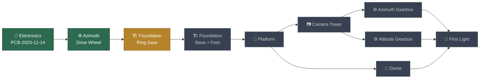
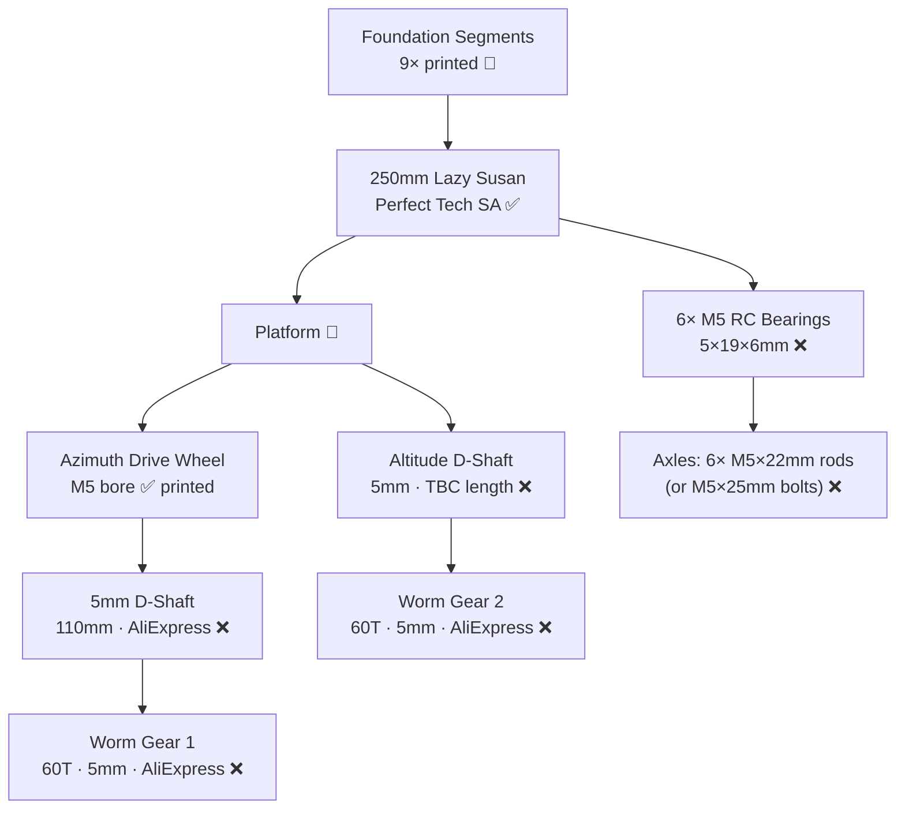

# 📋 Bill of Materials — Pi-Lomar Mini Observatory

> **Project**: Pi-Lomar 3D Printed Working Miniature Observatory  
> **Builder**: Kgotso Koete · **Revised**: 2 November 2026  
> **Source reference**: [Instructables](https://www.instructables.com/Pi-lomar-3D-Printed-Working-Miniature-Observatory-/) · [GitHub](https://github.com/Short-bus/pilomar)  
> **Primary BOM**: `docs/OBSOLETE_Legacy_Bill_of_Materials.csv` (your SA research — ZAR prices, SA suppliers)  
> **Gap-fill source**: [Community build sheet](https://docs.google.com/spreadsheets/d/1PMTY4k4qvsOA0pcBkmXHjJLgXibycWOeWZKqEL1s-4M) via `docs/OBSOLETE_Reference_BOM.csv` (EUR prices used only where your BOM has no price/supplier)  
> **Exchange rate for gap-fill**: 1 EUR = R18.63 (2 Nov 2026)  
> **Your SA BOM tracked spend**: R1,409.70

> [!NOTE]
> Neither source CSV contained hyperlinks — supplier names only. Links below were verified by web search. **Perfect Tech SA** could not be found online — you may need to confirm how you originally sourced them (phone, local market, etc.).

---

## Status Legend

| Symbol | Meaning |
|--------|---------|
| ✅ | Acquired & on hand |
| 🛒 | Ordered / in transit |
| ❌ | Not yet sourced |
| ⚠️ | Have it — but note applies |
| ⏭️ | Not needed — skipped |
| 🖨️ | Currently printing |
| 🔲 | Print not yet started |
| `[SA]` | Price/supplier from your SA BOM (primary) |
| `[COM]` | Gap-filled from community sheet (EUR converted) |

---

## Build Progress Overview

---

## Cat 1 — Electronics & Motorcontroller Board

> **PCB built**: PCB-2023-12-14 (Tiny2350 + DRV8825) ✅ Fully operational on Pi 5

| # | Description | Qty | Unit (R) | Duties (R) | Delivery (R) | Line Total (R) | Status | SA Supplier | Gap-fill Supplier |
|---|-------------|-----|----------|------------|--------------|----------------|--------|-------------|-------------------|
| 1 | Raspberry Pi 4B / **Pi 5** ≥2GB | 1 | — `[SA]` | — | — | — | ✅ | [PiShop](https://www.pishop.co.za) | — |
| 2 | 32GB micro SD card | 1 | — `[SA]` | — | — | — | ✅ | [PiShop](https://www.pishop.co.za) | [Amazon](https://www.amazon.co.uk) `[COM]` |
| 3 | Raspberry Pi USB-C power supply (27W for Pi 5) | 1 | — `[SA]` | — | — | — | ✅ | [PiShop](https://www.pishop.co.za) | — |
| 4 | Pimoroni Tiny2350 8MB, headered | 1 | R189.90 `[SA]` | R0 | R100.00 | **R289.90** | ✅ | [Pimoroni](https://www.pimoroni.com) / [PiShop](https://www.pishop.co.za) | [PiHut](https://thepihut.com) `[COM]` |
| 5 | NEMA17 0.9°/step 2A — 17HM19-2004S | 2 | R399.95 `[SA]` | R0 | R50.00 | **R899.90** | ✅ | [StepperOnline UK](https://www.omc-stepperonline.com) / [3D Printing Store](https://www.3dprintingstore.co.za) | [123-3D](https://www.123-3d.nl) `[COM]` |
| 6 | DRV8825 stepper motor driver board | 2 | R109.95 `[SA]` | R0 | R0 | **R219.90** | ✅ | [Pololu](https://www.pololu.com) / [3D Printing Store](https://www.3dprintingstore.co.za) / [PiShop](https://www.pishop.co.za) | [123-3D](https://www.123-3d.nl) `[COM]` |
| 7 | 47µF capacitors, 25V | 3 | R1.29 `[SA]` | R0 | R0 | — | ✅ | [DIY Electronics](https://www.diyelectronics.co.za) / [Communica](https://www.communica.co.za) | [Digikey](https://www.digikey.com) `[COM]` |
| 8 | BC548CTA NPN transistor | 1 | — `[SA]` | — | — | — | ✅ | [DIY Electronics](https://www.diyelectronics.co.za) | [RS Components SA](https://za.rs-online.com) (€0.06) `[COM]` |
| 9 | 40-way ribbon cable | 1 | — `[SA]` | — | — | — | ✅ | — | [AliExpress](https://www.aliexpress.com) `[COM]` |
| 10 | 40-way PCB header | 1 | — `[SA]` | — | — | — | ✅ | — | [AliExpress](https://www.aliexpress.com) ~R41 `[COM]` |
| 11 | Wire — signal (jumper/hookup) | 1 lot | — `[SA]` | — | — | — | ✅ | — | [123-3D](https://www.123-3d.nl) `[COM]` |
| 11a | Wire — **power 1.0mm² red** (Helukabel FLRY-B) | 5–6m | R5.46/m `[SA]` | — | — | ~R30 | ❌ | [Communica](https://www.communica.co.za) CAB28524 | — |
| 11b | Wire — **power 1.0mm² black** (Helukabel FLRY-B) | 5–6m | R5.46/m `[SA]` | — | — | ~R30 | ❌ | [Communica](https://www.communica.co.za) CAB28522 | — |
| 12 | Prototyping board / stripboard | 1 | — `[SA]` | — | — | — | ✅ | — | [Temu](https://www.temu.com) ~R93 `[COM]` |
| 13 | 320–680Ω resistor | 1 | — `[SA]` | — | — | — | ✅ | [DIY Electronics](https://www.diyelectronics.co.za) | [Temu](https://www.temu.com) `[COM]` |
| 14 | 10kΩ resistor | 1 | — `[SA]` | — | — | — | ✅ | [DIY Electronics](https://www.diyelectronics.co.za) | [Temu](https://www.temu.com) `[COM]` |
| 15 | 12V 8–8.5A power supply (Mean Well LRS-100-12) | 1 | — `[SA]` | — | — | — | ✅ | [ACDC Express](https://www.acdcexpress.com) | — |
| 15a | IEC C13 mains cable / SA 3-pin plug + 3-core cabtyre | 1 | — | — | — | ~R30 | ❌ | Hardware store / [Communica](https://www.communica.co.za) | — |
| 15b | Insulated fork/spade crimp terminals M3.5/M4 | 10 | — | — | — | ~R20 | ❌ | [Communica](https://www.communica.co.za) | — |

---

> [!NOTE]
> **Item 5 — Motor warning from community sheet**: Some suppliers incorrectly link to 1.8°/step (200 steps/rev) instead of the required **0.9°/step (400 steps/rev)**. Verify your 17HM19-2004S are the correct spec. If unsure, use Motor Tools → Tune Azimuth in Pilomar to count steps.

> [!NOTE]
> **Power wire**: Your PDF lists "Wire" at R0.00 with no supplier. Your SA research identified Communica 1.0mm² FLRY-B automotive cable (CAB28524 red / CAB28522 black) at R5.46/m — **use 1.0mm² minimum for 12V power, never 22 AWG**.

---

**Cat 1 SA BOM Subtotal (tracked)**: R1,409.70

---

## Cat 2 — Mechanical Hardware

> **Bore**: ✅ 5mm throughout — shafts, worm gears, drive wheels  
> **Constraint**: No on-site cutting. All rods must be pre-cut or cut-to-order by supplier.

---

| # | Description | Qty | Unit (R) | Line Total (R) | Status | SA Supplier | Gap-fill |
|---|-------------|-----|----------|----------------|--------|-------------|----------|
| 16 | 250mm Lazy Susan bearing | 1 | R200.00 `[SA]` | **R200.00** | ✅ | [Perfect Tech SA](https://perfecttech.co.za/product/metal-swivel-turn-table-plate-for-rotating-table/) | [Amazon.fr](https://www.amazon.fr) ~R772 `[COM]` |
| 17 | Steel rod 5mm Ø × 300mm length | 1 | — `[SA]` | — | ❌ | [AliExpress](https://www.aliexpress.com) `[SA]` | [Alibaba](https://www.alibaba.com) `[COM]` |
| 18a | Steel rod M5 Ø × 22mm length (Lazy Susan axles) | 6 | — `[SA]` | — | ❌ | [AliExpress](https://www.aliexpress.com) `[SA]` | [Alibaba](https://www.alibaba.com) `[COM]` |
| 18b | 60-tooth worm gear set, **5mm bore**, 1:60 | 2 | — `[SA]` | — | ❌ | [AliExpress](https://www.aliexpress.com) / [eBay](https://www.ebay.com) `[SA]` | Community: ~R484 total `[COM]` |
| 19a | M4×25mm countersunk screws | 8 | — `[SA]` | — | ❌ | Hardware store | [Temu](https://www.temu.com) `[COM]` |
| 19b | M5×25mm flanged button-head bolts | 30 | — `[SA]` | — | ❌ | Hardware store | [eBay](https://www.ebay.com) / [AliExpress](https://www.aliexpress.com) `[COM]` |
| 19c | M4 and M5 nuts and bolts assorted 12–30mm | 1 lot | — `[SA]` | — | ✅ | Hardware store `[SA]` | — |
| 20a | M5×30mm bolts | **30** | — `[SA]` | — | ❌ | Hardware store | [eBay](https://www.ebay.com) / [AliExpress](https://www.aliexpress.com) `[COM]` |
| 20b | M3×10mm screws | 8 | — | — | ❌ | Hardware store | 2× motors × 4 screws |
| 20c | M5 Nylock nuts | 40 | — | — | ❌ | Hardware store | — |
| 20d | 2.5mm nylon bolts | 4 | — | — | ❌ | Hardware store | Camera cradle mount |
| 21a | M5 6×19mm skateboard/RC bearings | 15 | — `[SA]` | — | ❌ | [AliExpress](https://www.aliexpress.com) / hobby shop `[SA]` | [Amazon](https://www.amazon.co.uk) ~R1,074 `[COM]` (qty 6) |
| 21b | M6 6×19mm skateboard/RC bearings | 5 | — `[SA]` | — | ❌ | [AliExpress](https://www.aliexpress.com) `[SA]` | May not be needed — 5mm build |
| 21c | M5 and M6 shaft collars with grub screws | 1 lot | — `[SA]` | — | ❌ | [AliExpress](https://www.aliexpress.com) `[SA]` | [Speedy](https://www.speedy.be) ~R42 `[COM]` |
| 22a | M6 flange coupler | 1 | — `[SA]` | — | ❌ | [AliExpress](https://www.aliexpress.com) `[SA]` | Optional — strong adhesive can substitute |
| 22b | M5 flange couplers | 2 | — | — | ❌ | [AliExpress](https://www.aliexpress.com) | ~R72 `[COM]` |
| 22c | Camera ribbon cable 30–40cm | 1 | — | — | ❌ | [PiShop](https://www.pishop.co.za) | [Digikey](https://www.digikey.com) ~R84 `[COM]` |
| 22d | Tamiya M/F connector plug set | 1 | — | — | ❌ | [AliExpress](https://www.aliexpress.com) | ~R35 `[COM]` |

---

> [!TIP]
> Lazy Susan bearing ✅ arrived — [Perfect Tech SA](https://perfecttech.co.za), Order #6910, 25cm / 250mm metal swivel plate at **R200.00**. Confirm it is truly 250mm OD before assembly. Some bearings labelled "25cm" are slightly under — measure before drilling/mounting foundation segments.

---

## Cat 3 — Camera & Optics

| # | Description | Qty | Unit (R) | Status | SA Supplier | Notes |
|---|-------------|-----|----------|--------|-------------|-------|
| C01 | Raspberry Pi HQ Camera (IMX477, 12.3MP) | 1 | — `[SA]` | ✅ | [PiShop](https://www.pishop.co.za) | FITS output on 64-bit only. Community ref: [Digikey](https://www.digikey.com) ~R1,065 `[COM]` |
| C02 | **25mm C-mount telephoto lens** | 1 | — | ✅ | — | Your chosen lens. Focus to ∞ before installation. |
| C03 | 16mm telephoto lens (original project spec) | 1 | — `[SA]` | ✅ | — | Community ref: [Digikey](https://www.digikey.com) ~R1,062 `[COM]` |

---

## Cat 4 — 3D Printed Parts

> **Printer**: Creality Ender 3 V2 · **Filament**: PETG  
> **Gear & foot parts**: 0.12mm layer height · **All other parts**: 0.2mm · 3–4 perimeters · 20–40% infill  
> **PETG**: Nozzle 230–245°C · Bed 70–80°C · Fan 30–50% · Retraction 4–6mm · Release agent on glass bed

---

### 4A — Azimuth Drive Wheel

| # | STL File | Qty (your BOM) | Qty (community) | Status | Notes |
|---|----------|----------------|-----------------|--------|-------|
| P01 | `B.13.2.AzimuthDriveM5.X1.stl` | 1 | 1 | ✅ **Done** | Pre-sliced gcode included (Ender 3 V2 · PETG · ~3h24m) |
| — | `B.13.2.AzimuthDriveM6.X1.stl` | 1 listed | N/A | ⏭️ | Not needed — 5mm bore chosen |

---

### 4B — Foundation

| # | STL File | Qty (your BOM) | Qty (community) | Status | Notes |
|---|----------|----------------|-----------------|--------|-------|
| P02 | `AG.13.6.RingGear.X1.stl` | 1 | 1 | 🖨️ **Printing** | 0.12mm layers · pre-sliced gcode ~15h34m |
| P03 | `A.13.6.Foundation.X9.stl` | 9 | 9 | 🔲 | |
| P04 | `AB.13.2.AdjustableFoot.X3.stl` | 3 | 3 | 🔲 | 0.12mm layers |
| P05 | `AC.13.6.AdjustableFoundation.X3.stl` | 3 | 3 | 🔲 | |
| P06 | `AE.13.7+FootRing.X1.stl` | 1 | 1 | 🔲 | |
| P07 | `38mmPeg` | 48 | 48 | 🔲 | Use leftover filament |

---

### 4C — Platform

| # | STL File | Qty (your BOM) | Qty (community) | Status | Notes |
|---|----------|----------------|-----------------|--------|-------|
| P08 | `E.13.6.DomeBearingBase.X1.stl` | 1 | 1 | 🔲 | |
| P09 | `D.13.5.DomeBase.X10.stl` | 10 | 10 | 🔲 | |
| P10 | `DaM4.X10.stl` | **10** | **4** | 🔲 | ⚠️ Quantity discrepancy — your BOM says 10, community says 4. Watch Step 7 video before printing. |
| P11 | `DaM5.X10.stl` | **10** | **1** | 🔲 | ⚠️ Community note: "count from Step 7 assembly image (white)." Watch video before printing. |
| P12 | `G.13.1.WallMount.X2.stl` | 2 | 2 | 🔲 | |
| P13 | `38mmPeg` | 30 | 30 | 🔲 | |
| P14 | `18mmPeg` | 30 | 36 | 🔲 | ⚠️ Minor discrepancy — print 36 to be safe |

---

### 4D — Camera Tower

| # | STL File | Qty (your BOM) | Qty (community) | Status | Notes |
|---|----------|----------------|-----------------|--------|-------|
| P15 | `P.14.0.InnerWall.X2.stl` | 2 | 1 | 🔲 | Choose P.14.0 OR P.13.6 — not both. P.14.0 = more dome clearance |
| P16 | `P.13.6.InnerWall.X2.stl` | 2 | 1 | 🔲 | P.13.6 = more mount holes (demo video uses this) |
| P17 | `R.13.3.AltitudeHub.X2.stl` | **2** | **1** | 🔲 | ⚠️ Discrepancy — your BOM says 2. Print 2. |
| P18 | `GA.13.1.Brace.X1.stl` | 1 | 2 | 🔲 | ⚠️ Discrepancy — community says 2. Print 2 to be safe. |
| P19 | `L.13.4.AzimuthBrace.X2.stl` | **2** | **1** | 🔲 | ⚠️ Discrepancy — your BOM says 2. Print 2. |
| P20 | `G.13.1.WallMount.X2.stl` | 2 | — | 🔲 | |
| P21 | `W.13.1.CameraCradle.X1.stl` | 1 | 1 | 🔲 | Mount camera with 4× 2.5mm nylon bolts |
| P22 | `WL.13.2.LensCradle.X1.stl` | 1 | — | 🔲 | Test-fit 25mm lens before final print |
| P23 | `Y.13.1.CableRing.X1.stl` | 1 | 1 | 🔲 | Community note: "check qty" |

---

### 4E — Azimuth Gearbox

| # | STL File | Qty (your BOM) | Qty (community) | Status | Notes |
|---|----------|----------------|-----------------|--------|-------|
| P24 | `JB.13.7.AzimuthMotor.X1.stl` | 1 | 1 | 🔲 | ⚠️ **Label immediately on removal from bed** — looks identical to altitude housing |
| P25 | `JC.13.1.TensionArm.stl` | — | 1 | 🔲 | ⚠️ In community BOM but not in your CSV or the repo parts folder — check if needed |

---

### 4F — Altitude Gearbox

| # | STL File | Qty (your BOM) | Qty (community) | Status | Notes |
|---|----------|----------------|-----------------|--------|-------|
| P26 | `JA.13.7.AltitudeMotor.X1.stl` | 1 | 1 | 🔲 | ⚠️ **Label immediately** — NOT interchangeable with azimuth housing |
| P27 | `S.13.2.12TM1-5mm.X1.stl` | 1 | 1 | 🔲 | 5mm bore ✅ confirmed |
| P28 | `T.13.8.AltitudeBracket.X1.stl` | 1 | 1 | 🔲 | |
| — | `S.13.2.12TM1-6mm.X1.stl` | listed | listed | ⏭️ | Not needed — 5mm build |

---

### 4G — Electronics Mount

| # | STL File | Qty (your BOM) | Qty (community) | Status | Notes |
|---|----------|----------------|-----------------|--------|-------|
| P29 | `NA.14.3.MicrocontrollerHolder.X1.stl` | 1 | 1 | 🔲 | Guide only — may need custom mount for your PCB layout |
| P30 | `N.14.3.PiMount.stl` | — | 1 | 🔲 | Community-only item. Pi mount plate — Pi 5 uses same holes as 4B |

---

### 4H — Dome

| # | STL File | Qty (your BOM) | Qty (community) | Status | Notes |
|---|----------|----------------|-----------------|--------|-------|
| P31 | `Wall.13.2.X8.stl` | 8 | 8 | 🔲 | Do NOT glue dome to lower walls or platform |
| P32 | `Dome.13.1.Segment.X8.stl` | 8 | 8 | 🔲 | Can glue segments to each other |
| P33 | `Dome.13.3.CapAR.X1.stl` | 1 | 1 | 🔲 | |
| P34 | `Dome.13.3.CapAL.X1.stl` | 1 | 1 | 🔲 | If glued to dome body → must remove whole dome to access interior |
| P35 | `Dome.13.1.SideA1.X1.stl` | 1 | 1 | 🔲 | Use slicer mirror for paired parts |
| P36 | `Dome.13.1.SideA2.X1.stl` | 1 | 1 | 🔲 | |
| P37 | `Dome.13.1.SideB1.X1.stl` | 1 | 1 | 🔲 | |
| P38 | `Dome.13.1.SideB2.X1.stl` | 1 | 1 | 🔲 | |
| P39 | `13.2.DoorA1.X1.stl` | 1 | 1 | 🔲 | |
| P40 | `13.2.DoorA2.X1.stl` | 1 | 1 | 🔲 | |
| P41 | `13.2.DoorB1.X1.stl` | 1 | 1 | 🔲 | |
| P42 | `13.2.DoorB2.X1.stl` | 1 | 1 | 🔲 | |
| P43 | `78mmPeg.X24.stl` | 24 | 24 | 🔲 | |
| P44 | `38mmPeg.X8.stl` | 8 | 8 | 🔲 | |
| P45 | `18mmPeg.X36.stl` | 36 | 36 | 🔲 | 0.12mm layers per community note |

---

**Total pegs**: 48+30+30+36+8+24 = **176** — print as background/overnight jobs

---

## Quantity Discrepancies — Action Required

> Items where your SA BOM and the community sheet disagree. Watch the relevant assembly video before printing.

| Part | Your BOM Qty | Community Qty | Recommendation |
|------|-------------|---------------|----------------|
| `DaM4.stl` | 10 | 4 | Watch Step 7 assembly video before printing |
| `DaM5.stl` | 10 | 1 | Watch Step 7 assembly video before printing |
| `18mmPeg` (platform) | 30 | 36 | Print 36 to be safe |
| `R.13.3.AltitudeHub` | 2 | 1 | Print 2 (your BOM is the official count) |
| `GA.13.1.Brace` | 1 | 2 | Print 2 to be safe |
| `L.13.4.AzimuthBrace` | 2 | 1 | Print 2 (your BOM is the official count) |
| `JC.13.1.TensionArm` | not listed | 1 | Community-only — check if file exists and if needed |

---

## Cost Summary

| Category | Your SA BOM (R) | Notes |
|----------|-----------------|-------|
| Electronics (tracked) | R1,409.70 | Tiny2350 R289.90 · Motors R899.90 · DRV8825 R219.90 · Caps R1.29×3 |
| Power wiring (Communica) | ~R80 | 1.0mm² FLRY-B red + black + crimp terminals — **to buy** |
| Mechanical hardware | Prices TBD | Most items still R0.00 in your BOM — research in progress |
| Camera & optics | On hand | Pi HQ Camera + 25mm lens |
| 3D printed parts | PETG filament only | ~4 spools estimated (1kg each) |
| **SA BOM Total (tracked)** | **R1,409.70** | Balance of mechanical still to be priced |

---

## SA Supplier Reference

> Links verified by web search — source CSVs contained supplier names only, no URLs.  
> ⚠️ = URL not confirmed or business not found online.

| Supplier | Items | Link |
|----------|-------|------|
| [PiShop](https://www.pishop.co.za) | Pi 5, camera, SD card, USB-C PSU | pishop.co.za |
| [Pimoroni](https://www.pimoroni.com) | Tiny2350 | pimoroni.com |
| [StepperOnline UK](https://www.omc-stepperonline.com) | NEMA17 17HM19-2004S motors | omc-stepperonline.com |
| [3D Printing Store](https://www.3dprintingstore.co.za) | DRV8825, motors (local SA) | 3dprintingstore.co.za |
| [Pololu](https://www.pololu.com) | DRV8825 | pololu.com |
| [DIY Electronics](https://www.diyelectronics.co.za) | Transistor, resistors, capacitors | diyelectronics.co.za |
| [Communica](https://www.communica.co.za) | Power wire CAB28524/CAB28522, crimp terminals | communica.co.za |
| [ACDC Express](https://www.acdcexpress.com) | Mean Well 12V PSU | acdcexpress.com — formerly "AC DC" in your CSV |
| [Perfect Tech SA](https://perfecttech.co.za) | 250mm Lazy Susan bearing ✅ arrived | perfecttech.co.za · Order #6910 · R200.00 |
| [AliExpress](https://www.aliexpress.com) | 5mm rods, worm gears, bearings, collars | aliexpress.com |
| [Alibaba](https://www.alibaba.com) | Metal rods (community sheet source) | alibaba.com |
| [FDM3D Benoni](https://www.fdm3d.co.za) | 5mm D-shaft (ask to cut to 110mm) | 083 395 1909 · info@fdm3d.co.za |
| [RS Components SA](https://za.rs-online.com) | Passives (gap-fill) | za.rs-online.com |
| [Digikey](https://www.digikey.com) | Camera, passives (gap-fill) | digikey.com |
| [PiHut](https://thepihut.com) | Tiny2040 (community sheet source) | thepihut.com |
| [123-3D](https://www.123-3d.nl) | DRV8825, motors, wire (community sheet) | 123-3d.nl |
| [Takealot](https://www.takealot.com) | Lazy Susan bearing alternative (SA) | takealot.com |
| [Bob Shop](https://www.bobshop.co.za) | Lazy Susan bearing alternative (SA) | bobshop.co.za |
| Hardware store | M3–M5 bolts, nylock nuts, nylon bolts | Builders Warehouse / Bolt & Engineering |
