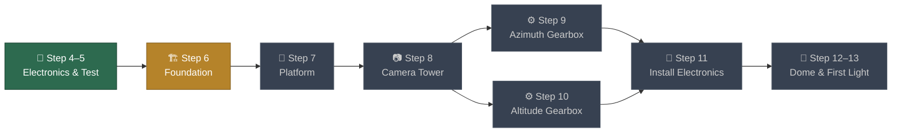
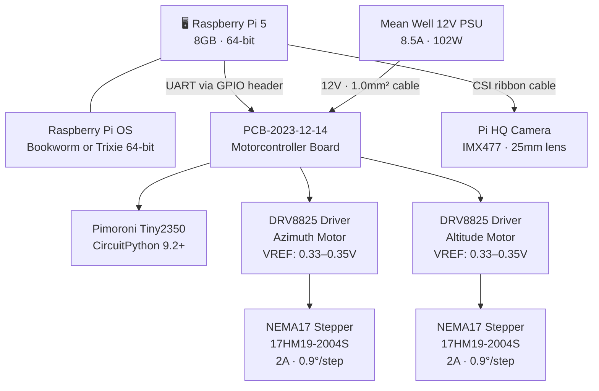
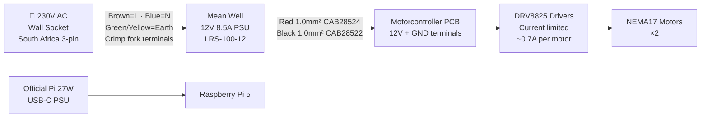
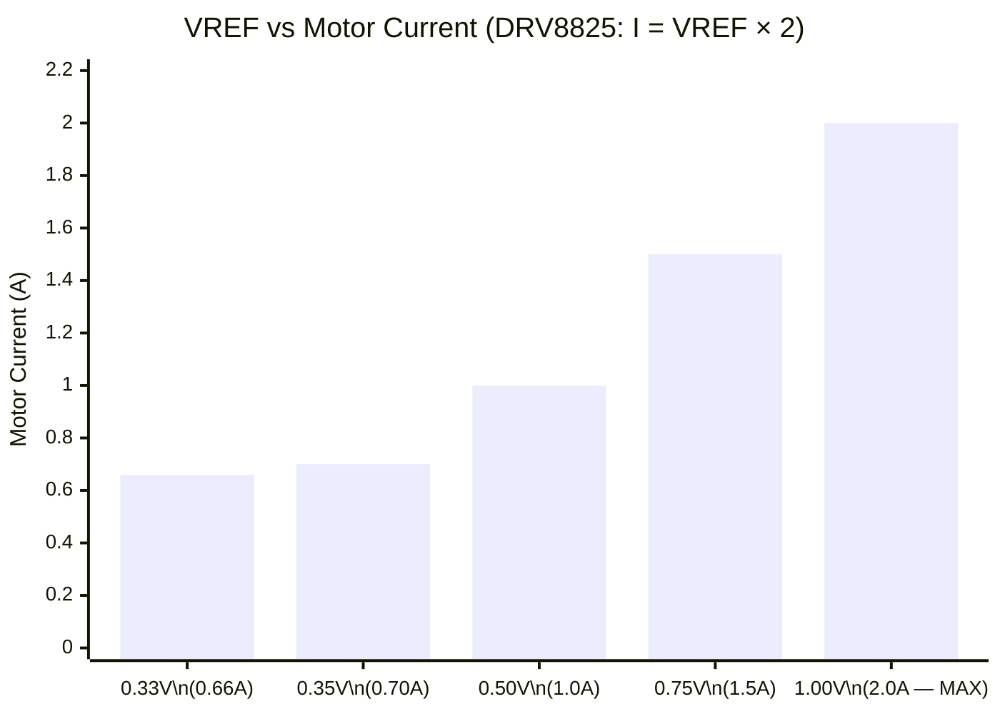
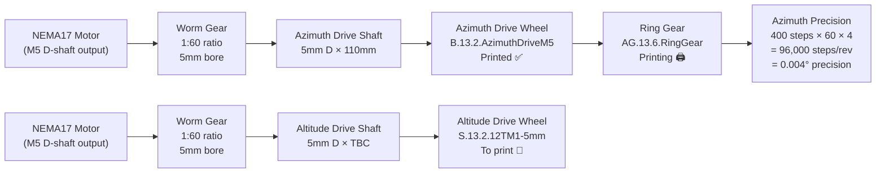
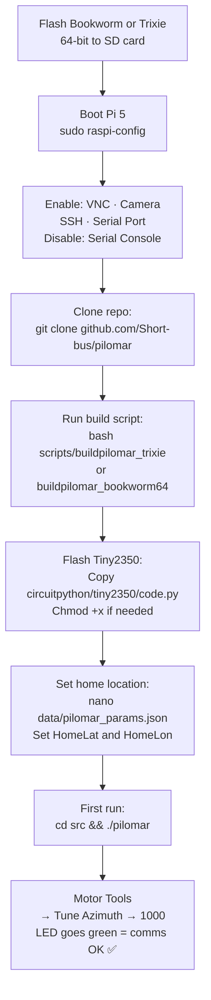

# 🔭 Pilomar Build Tracker

> **Last updated**: 2 November 2026 · **Builder**: Kgotso Koete  
> **Printer**: Creality Ender 3 V2 · **Filament**: PETG  
> **Pi**: Raspberry Pi 5 (8GB, 64-bit) · **PCB**: PCB-2023-12-14 (Tiny + DRV8825) ✅

---

## Build Stage Overview

---

| Stage | Step | Status |
|-------|------|--------|
| Electronics & motorcontroller board | Step 4 | ✅ Done |
| Test motorcontroller | Step 5 | ✅ Done — Pilomar started, both motors ran |
| Build foundation | Step 6 | 🖨️ Ring Gear printing · Parts pending |
| Build platform | Step 7 | 🔲 Not started |
| Build camera tower | Step 8 | 🔲 Not started |
| Build azimuth gearbox | Step 9 | 🔲 Not started |
| Build altitude gearbox | Step 10 | 🔲 Not started |
| Install electronics & camera | Step 11 | 🔲 Not started |
| Dome, first light, tune | Step 12–13 | 🔲 Not started |

---

## Hardware Configuration

---

## Power Architecture

> [!CAUTION]
> Never power the Tiny2350 from USB and the GPIO header simultaneously. Disconnect USB before connecting to the Pi.

---

## DRV8825 Current Limit Reference

---

| VREF | Motor Current | Status | Notes |
|------|--------------|--------|-------|
| 0.33V | 0.66A | ✅ Set (U1) | Safe starting point |
| 0.35V | 0.70A | ✅ Set (U2) | Author's recommended start |
| 0.50V | 1.00A | ⬆️ Increase if needed | If motors struggle or skip steps |
| 1.00V | 2.00A | ❌ Max rated | Never run here — overheating |

Formula: `VREF = Target Current ÷ 2`

---

## Wire Size Reference

```mermaid
flowchart LR
    A["0.33mm² / 22 AWG\n~5A safe"]:::bad
    B["0.5mm² / 20 AWG\n~7A safe"]:::bad
    C["0.75mm² / 18 AWG\n~10A safe"]:::warn
    D["1.0mm² / 17 AWG\n12–15A safe"]:::good
    E["1.5mm² / 16 AWG\n15–18A safe"]:::great

    A -- "❌ Signal only\n(NOT for 12V power)" --> B
    B -- "❌ Zero margin" --> C
    C -- "⚠️ Bare minimum" --> D
    D -- "✅ Buy this\nCommunica CAB28524/22" --> E
    E -- "✅ Even better" --> E

    classDef bad fill:#7f1d1d,color:#fca5a5,stroke:#991b1b
    classDef warn fill:#78350f,color:#fde68a,stroke:#92400e
    classDef good fill:#14532d,color:#86efac,stroke:#166534
    classDef great fill:#1e3a5f,color:#93c5fd,stroke:#1d4ed8
```

---

## Shaft & Drive Train Layout

---

## 3D Print Progress

```mermaid
flowchart TD
    subgraph DONE["✅ Done"]
        P01["B.13.2.AzimuthDriveM5\n×1 · 3h24m · PETG"]
    end

    subgraph NOW["🖨️ Now Printing"]
        P02["AG.13.6.RingGear\n×1 · ~15h34m · PETG"]
    end

    subgraph S2["🔲 Section 2 — Foundation (next up)"]
        P03["A.13.6.Foundation × 9"]
        P04["AB.13.2.AdjustableFoot × 3\n0.12mm layers"]
        P05["AC.13.6.AdjustableFoundation × 3"]
        P06["AE.13.7+FootRing × 1"]
        P07["38mmPeg × 48"]
    end

    subgraph S3["🔲 Section 3 — Platform"]
        P08["D.13.5.DomeBase × 10"]
        P09["E.13.6.DomeBearingBase × 1"]
        P10["DaM4 × 10 + DaM5 × 10"]
        P11["G.13.1.WallMount × 2"]
        P12["Pegs × 60"]
    end

    subgraph S4["🔲 Section 4 — Camera Tower"]
        P13["P.14.0 or P.13.6 InnerWall × 2"]
        P14["AltitudeHub × 2 · Braces · Mounts"]
        P15["CameraCradle + LensCradle"]
        P16["CableRing × 1"]
    end

    subgraph S5["🔲 Sections 5 & 6 — Gearboxes"]
        P17["JB.13.7.AzimuthMotor × 1\n⚠️ Label it!"]
        P18["JA.13.7.AltitudeMotor × 1\n⚠️ Label it!"]
        P19["S.13.2.12TM1-5mm × 1"]
        P20["T.13.8.AltitudeBracket × 1"]
    end

    subgraph S7["🔲 Section 7 — Dome"]
        P21["Dome Segments × 8\nWalls × 8"]
        P22["Side panels × 4\nDoors × 4\nCaps × 2"]
        P23["Pegs × 68 (18/38/78mm)"]
    end

    DONE --> NOW --> S2 --> S3 --> S4 --> S5 --> S7
```

---

## OS & Software

### OS Decision

| OS | Status | Notes |
|----|--------|-------|
| **Raspberry Pi OS Bookworm (64-bit)** | ✅ Fully supported | Author-tested. Use `buildpilomar_bookworm64` |
| **Raspberry Pi OS Trixie (64-bit)** | ✅ Viable | Debian 13.7, stable since Aug 2025. `buildpilomar_trixie` exists in repo — nearly identical script. Use if Pi 5 already runs Trixie. |
| Raspberry Pi OS Buster (32-bit) | ❌ Legacy only | Needed only for Pi 3B+ (not primary build) |

---

### Software Setup Sequence

---

## Open Questions

1. ❓ **Tiny2040 or Tiny2350?** — determines which CircuitPython version (7.2/8.2 vs 9.2+)
2. ❓ **Trixie or Bookworm** on your Pi 5?
3. ❓ **Worm gears ordered yet?** — must be 5mm bore, 1:60 ratio (AliExpress lead time can be weeks)
4. ❓ **FDM3D contacted** about cutting 5mm D-shaft to 110mm?
5. ❓ **Which inner wall version?** — P.14.0 (more dome clearance) or P.13.6 (more mount holes)

---

## Build Log

| Date | Event | Details |
|------|-------|---------|
| 2 Nov 2026 | Build tracker created | Consolidated from research and prior conversation |
| 2 Nov 2026 | PCB-2023-12-14 built | Tiny + DRV8825, from gerber files, all soldered |
| 2 Nov 2026 | Electronics tested | Pilomar started on Pi 5, both motors responded ✅ |
| 2 Nov 2026 | DRV8825 current set | U1: VREF 0.33V (0.66A) · U2: VREF 0.35V (0.70A) |
| 2 Nov 2026 | Bore size decided | **5mm** — M5 STL variants throughout |
| 2 Nov 2026 | `B.13.2.AzimuthDriveM5` printed | ✅ PETG · Ender 3 V2 · ~3h24m |
| 2 Nov 2026 | `AG.13.6.RingGear` printing | 🖨️ PETG · ~15h34m |
| 2 Nov 2026 | Power wiring decided | 1.0mm² Helukabel FLRY-B · Communica CAB28524 (red) + CAB28522 (black) |
| 2 Nov 2026 | OS question resolved | Trixie = Debian 13 stable · `buildpilomar_trixie` exists in repo |
| 2 Nov 2026 | BOM created | Full BOM in `docs/BILL_OF_MATERIALS.md` from PDF source |
| 18 May 2026 | 250mm Lazy Susan arrived | ✅ [Perfect Tech SA](https://perfecttech.co.za) · Order #6910 · R200.00 · 25cm metal swivel plate |
